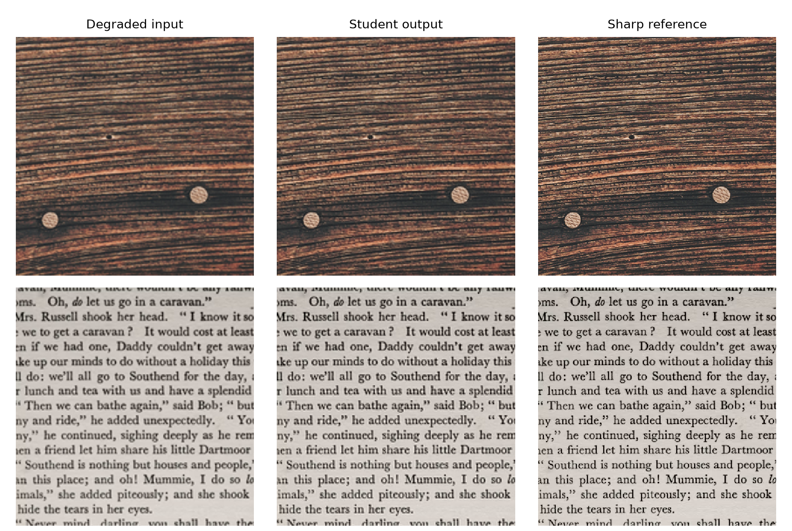
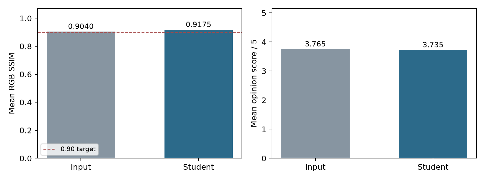

# Real-Time Image Sharpening for Video Conferencing Using Knowledge Distillation

**Student:** Siddharth V  
**College:** Manipal Institute of Technology  
**Date:** 26 October 2026

This is the editable text version. The two-column research-paper layout is in `research_paper.pdf`.

## Abstract

This project develops a lightweight model to sharpen video frames in real time. A pretrained SwinIR model acts as the teacher, and a small convolutional model is trained as the student. Following the problem statement, high-quality images were reduced to half resolution and enlarged with bicubic interpolation to simulate loss of detail. The final student has 2,380 trainable parameters. On 125 test images, it obtained a mean RGB SSIM of **0.9175**, above the required 0.90. OpenVINO processing at 1920×1080 on an Intel Iris Xe GPU averaged **48.03 FPS** in a controlled benchmark. Two webcam screenshots showed 35.8 and 40.6 processing FPS. A blinded study with ten volunteers did not show a clear visual preference for the sharpened output. The system is a working real-time prototype for simulated resolution loss; it has not been validated for all types of poor network video.

## 1. Problem and objective

The Intel Unnati problem statement asks for an ultra-lightweight teacher–student image-sharpening model for video conferencing. It specifies 1920×1080 processing at 30–60 FPS or higher, SSIM above 0.90, a test set of more than 100 images from diverse categories, and a Mean Opinion Score (MOS) study. It also specifies downscaling and upscaling sharp images using bicubic or bilinear interpolation to simulate reduced video clarity. This project follows that test setup.

## 2. Dataset and training

The DIV2K training images were split into 750 training images and 50 images for selecting a checkpoint. Training used 256×256 crops, random flips and rotations, and a fixed random seed of 2110. Each sharp crop was downscaled by 2× and enlarged using bicubic interpolation. The sharp crop was the target image.

The teacher was the official pretrained SwinIR-S ×2 super-resolution model. The student uses 16 feature channels, four depthwise residual blocks, and a pixel-shuffle correction layer. It works internally at half resolution and returns a full-resolution frame. The student was trained for 12 epochs in Google Colab using a Tesla T4 GPU, Adam with an initial learning rate of 0.0002, and batch size four. Its loss combined error against the sharp target, image-gradient error, and guidance from the teacher output. The best downloaded checkpoint came from epoch 11. Exact training time was not recorded.

## 3. Image-quality evaluation

The final test set contained **125 images**: 100 untouched DIV2K validation images and 25 extra images, five each from text, nature, people, animals, and games. The extra images were supplied as AVIF files and converted to PNG for evaluation. No final-test image was used for training.

Scores were calculated over RGB 8-bit images, with a two-pixel border crop and an SSIM data range of 255. The same bicubic degradation was used for every test image.

| Method | Test images | Mean RGB SSIM | Mean RGB PSNR |
|---|---:|---:|---:|
| Bicubic degraded input | 125 | 0.9040 | 31.0119 dB |
| Final student output | 125 | **0.9175** | **31.6990 dB** |

The student raised mean SSIM by 0.0135 and PSNR by 0.6872 dB over the degraded input. It met the brief's mean SSIM target. The improvement was measurable, but small enough that it was not always obvious in a side-by-side preview.

*Figure: Native-resolution matched crops. Top: DIV2K image 0885; bottom: a text-category test image. These are selected examples; the 125-image averages above are the main result.*

## 4. Full-HD speed and live demonstration

The trained student was exported to OpenVINO for 1920×1080 BGR video frames. The test laptop was a Lenovo Yoga Slim 6i with a 13th-generation Intel Core i5-13500H, 16 GB RAM, and Intel Iris Xe graphics. With batch size one, ten warmup runs and 50 timed runs, the GPU averaged 18.09 ms per model call (55.29 FPS) and 20.82 ms per complete frame-processing call (**48.03 FPS**). This benchmark excludes camera capture, display, and video encoding.

The webcam app processed full-HD frames and showed smaller side-by-side previews. Two screenshots of the final model showed **35.8** and **40.6 processing FPS**. These are readings at two moments, not a sustained one-minute average. The visible sharpening was subtle, especially where the webcam itself was soft or the preview was reduced in size.

## 5. Human Mean Opinion Score study

Twenty native-resolution detail crops were taken from untouched DIV2K validation images. The degraded input and final student output were shown in randomized A/B order, without labels revealing the method. Ten volunteers rated A and B separately from 1 (very poor) to 5 (excellent). Each volunteer rated all 20 pairs, giving 200 paired ratings. Equal scores were allowed.

| Image | Individual ratings | MOS | Sample standard deviation |
|---|---:|---:|---:|
| Degraded input | 200 | **3.765 / 5** | 0.665 |
| Final student output | 200 | 3.735 / 5 | 0.653 |

The student received a higher rating in 43 pairs, the same rating in 108, and a lower rating in 49. The MOS difference was −0.030 points (student minus input). The study therefore **does not show that volunteers preferred the sharpened images**. Ten volunteers is a modest sample for a subjective study; more independent ratings would make this conclusion stronger.

*Figure: SSIM improved under the controlled test, while MOS was nearly unchanged.*

## 6. Limitations and conclusion

This model is trained for detail lost through a controlled 2× bicubic downscale/upscale process. Actual poor internet video may also include compression blocks, packet loss, dropped frames, low light, or motion blur. The present results do not establish that the model repairs those conditions. The model processes frames independently, so temporal flicker is possible. The application is a standalone demo rather than a virtual camera for a conferencing service.

The project meets the specified image count, mean SSIM, and measured full-HD processing-speed targets under the controlled setup. Its main limitation is perceptual: the improvement was subtle and the ten-person MOS study showed no preference for the output. A useful next experiment would train and test on compressed video while checking whether visual quality and speed both improve.

## References

1. Intel Unnati Industrial Training 2025, Problem Statement 2, *Image Sharpening using knowledge distillation* (supplied brief).
2. E. Agustsson and R. Timofte, *NTIRE 2017 Challenge on Single Image Super-Resolution: Dataset and Study*, CVPR Workshops 2017. [DIV2K](https://data.vision.ee.ethz.ch/cvl/DIV2K/).
3. J. Liang et al., *SwinIR: Image Restoration Using Swin Transformer*, ICCV Workshops 2021. [Official implementation](https://github.com/JingyunLiang/SwinIR).
